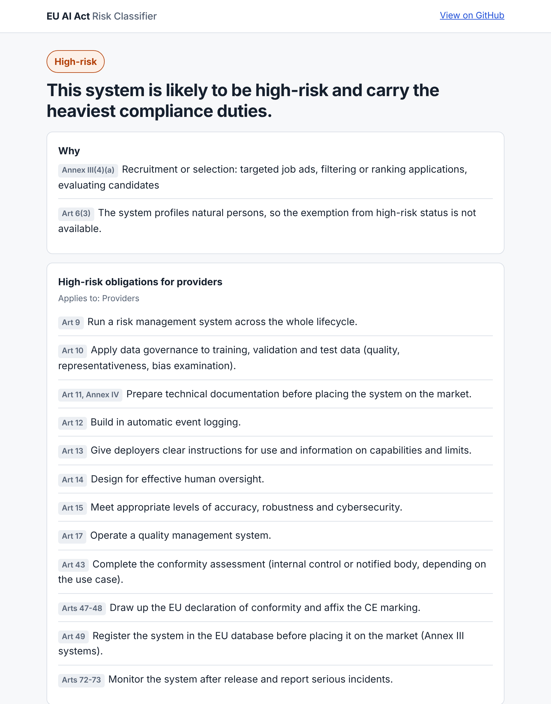

# EU AI Act Risk Classifier

[](https://github.com/pJijesh/eu-ai-act-risk-classifier/actions/workflows/test.yml) [](LICENSE)  

**Problem:** Most organisations using AI cannot quickly tell which EU AI Act obligations apply to them, or when.

**For:** IT, compliance and product leaders who need a first-pass answer before engaging lawyers.

**Demonstrates:** Turning a regulation into a tested rules engine, a web app and a CLI, with no dependencies and nothing sent anywhere.

[**Try it in your browser**](https://pjijesh.github.io/eu-ai-act-risk-classifier/) &nbsp;|&nbsp; [Report an error in the rules](../../issues)



You answer up to ten short questions. You get:

- the risk tier (out of scope, prohibited, high-risk, possible Art 6(3) exemption, general-purpose AI model, transparency, minimal)
- the reasons, with article and annex references
- the obligations for your role (provider, deployer, importer, distributor or product manufacturer)
- the dates that matter, with a live "already in force" or "in N days" status
- the penalty bands
- a Markdown report you can download, and a link that reproduces the result

> Educational triage tool, not legal advice. Check the Official Journal text and take qualified advice before relying on a result.

## Quick start

**Web app.** Open the [live demo](https://pjijesh.github.io/eu-ai-act-risk-classifier/), or run it locally:

```bash
git clone https://github.com/pJijesh/eu-ai-act-risk-classifier
cd eu-ai-act-risk-classifier
npm run serve        # then open http://localhost:8080
```

**Command line** (Node 18 or later, no install step):

```bash
node bin/classify.js examples/cv-screening-provider.json     # Markdown report
node bin/classify.js examples/cv-screening-provider.json --json
node bin/classify.js --interactive                           # answer in the terminal
```

**Tests:**

```bash
npm test
```

## What it does with your answers

| Step | Check | Result |
| --- | --- | --- |
| 1 | Is there an EU nexus, and does an Art 2 exclusion apply (military, pure research, pre-launch testing, personal use)? | Out of scope |
| 2 | Is any Art 5 prohibited practice present? | Prohibited. The assessment stops here. |
| 3 | Is it an Annex I product safety component, or an Annex III use case? | High-risk |
| 3a | If Annex III and no profiling of people, does an Art 6(3) condition apply? | Possible exemption, with documentation duties |
| 4 | Do you provide a general-purpose AI model, with or without systemic risk? | GPAI layer (Arts 53, 55) |
| 5 | Do any Art 50 transparency triggers apply? | Transparency layer |
| 6 | Always, for anything in scope | AI literacy (Art 4) |

A system can sit in several categories. The primary tier is the highest one, and the other duties appear as separate layers.

## Dates this tool uses

Verified on 4 November 2026 against law-firm and regulator commentary. Confirm on [EUR-Lex](https://eur-lex.europa.eu/) before relying on them.

| Date | What applies |
| --- | --- |
| 2 Feb 2025 | Prohibited practices and AI literacy |
| 2 Aug 2025 | General-purpose AI model obligations |
| 2 Aug 2026 | Transparency obligations (Art 50) |
| 2 Dec 2026 | End of the marking grace period for generative systems already on the market, and the new ban on non-consensual intimate imagery and child sexual abuse material |
| 2 Dec 2027 | High-risk obligations for Annex III use cases (moved from 2 Aug 2026 by the Digital Omnibus on AI) |
| 2 Aug 2028 | High-risk obligations for AI in Annex I regulated products (moved from 2 Aug 2027) |

## How it is built

```
src/rules.js     questions, options, obligations, dates, penalties (the single source of truth)
src/engine.js    pure classify() function, input validation, question flow
src/report.js    Markdown report
index.html       static web app, no build step (assets/app.js, assets/styles.css)
bin/classify.js  command-line front end
examples/        nine worked scenarios, each also used as a test
test/            22 tests with an injectable clock, so date logic is deterministic
```

Design choices worth knowing about:

- **One rules file.** The web app, the CLI and the tests all read `src/rules.js`, so they cannot drift apart. Changing an obligation or a date is a one-line edit.
- **Pure engine.** `classify(answers, now)` has no side effects and takes the clock as a parameter, which is what makes the date tests reliable.
- **Strict validation.** Unknown values and missing required answers are rejected with readable messages instead of producing a misleading result.
- **Private by design.** The page is static. Answers stay in the browser, and the shareable link carries them in the URL fragment, which is never sent to a server.
- **Accessible.** Native form controls, keyboard operation, visible focus, light and dark themes, no horizontal scrolling on a phone.

## Limitations

- It is a triage tool. Whether a system really falls under Annex III, or whether an Art 6(3) condition is met, often needs legal judgement.
- Commission guidelines and harmonised standards are still being published, so borderline cases can change.
- It covers the AI Act only. GDPR, product safety, consumer, employment and sector rules are out of scope.
- Open-source and SME-specific relief, notified body routes and sandbox rules are not modelled.

## Publish your own copy on GitHub Pages

Settings, then Pages, then deploy from branch `main` and folder `/ (root)`. There is no build step.

## Licence

MIT. See [LICENSE](LICENSE).

Built by [Jijesh Puliyappottammal](https://www.linkedin.com/in/pjijesh). I also work on AI governance and write about it, including the *AI Governance Playbook*.
